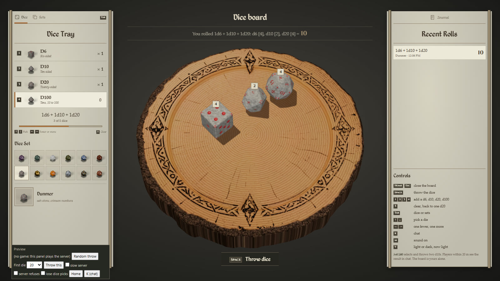
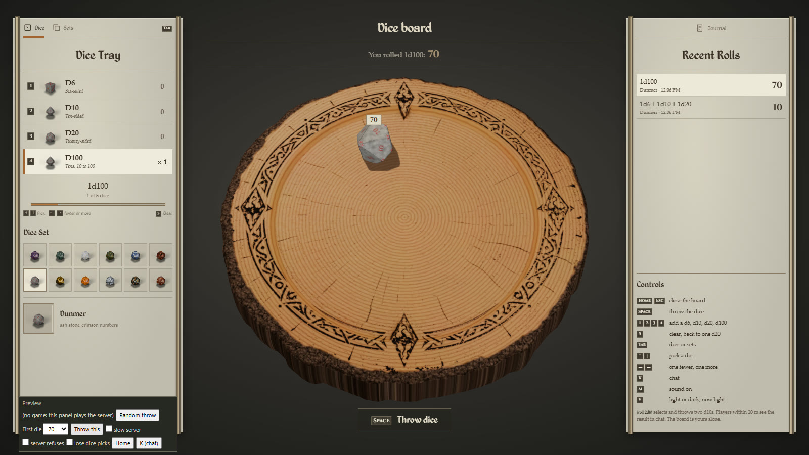

# RpRoll

Dice for roleplay on [Oblivion Multiplayer (OB:MP)](https://docs.ready.mp/oblivion-mp/docs/what-is-oblivion-mp) servers by ReadyM. Type `/roll` or open a 3D dice board, throw, and every player standing near you sees the result in chat.



*The dice board in the browser preview (see [Try the board in a browser](#try-the-board-in-a-browser)). In game the preview panel at the bottom left is not there.*

## What it is for

Roleplay groups often need a fair roll: who wins an arm-wrestle, whether the lockpick holds, how a bet ends. RpRoll gives them one that nobody can fake. The server rolls, the result goes to everyone nearby, and the players decide what it means. The mod applies no game rules: no skill checks, no automatic contests, no effects on your character.

## Features

- **`/roll` in chat** with d6, d10, d20 and d100, mixed in one roll (`/roll 1d20+2d6`), up to 5 dice. `/roll` alone is `1d20`.
- **Results are shown to players within 20 m** in the same area. Each interior is its own area, so the house next door doesn't see your roll. Every line shows who rolled, each die and the total:
  `Pete rolled 1d20 + 2d6: d20 [14], d6 [3], d6 [5] = 22`
- **A 3D dice board** (Home, or `/board` in chat): a wooden board and up to 5 dice. Space throws them, and each die lands on the number the server rolled.
- **12 cosmetic dice sets:** Altmer, Argonian, Ayleid, Bosmer, Breton, Daedric, Dunmer, Imperial, Khajiit, Nord, Orc and Redguard. Any player can pick any set; a set is only a look and changes nothing about the roll.
- **Light and dark board** (V). The page remembers the choice, and the dice set, for the next session.
- **HUD message:** while the chat window is closed, roll results (yours and those of players near you) also appear in the game's own message in the middle of the screen for about 5 seconds.
- **Dice sounds** made by the page itself (no sound files). M mutes them.

The d100 is a ten-sided die numbered 10, 20 ... 100. For a value like 87, throw a d100 and a d10 together and add them up: `/roll d100+d10` gives `d100 [80], d10 [7] = 87`.

## How a roll works

1. The player asks for a roll: `/roll ...` in chat, or Space on the board. The client only sends what was asked for (the text, or how many of each die), never a number.
2. The server parses and checks it (known dice, 1 to 5 dice), rolls with a cryptographic random source and builds the result. The player's name comes from the server, not from the client.
3. Chat shows the line to everyone in range. A rejected roll (`/roll d8`) is answered only to the player who sent it.
4. For a board throw, the server also sends the numbers back to the roller through RpRoll's own RPC. The page simulates the throw with its own small physics engine, then turns each die's markings by a symmetry of its shape, so the face that ends on top carries the server's number. The motion is a real simulation; only which number is printed on which face changes.

The board is only on the roller's screen. Other players see the chat line.

## Controls

**Chat**

| You type | You see |
|---|---|
| `/roll` | `Pete rolled 1d20: d20 [14] = 14` |
| `/roll 2d6` | `Pete rolled 2d6: d6 [4], d6 [3] = 7` |
| `/roll 1d20+2d6` | `Pete rolled 1d20 + 2d6: d20 [14], d6 [3], d6 [5] = 22` |
| `/roll d100+d10` | `Pete rolled 1d100 + 1d10: d100 [80], d10 [7] = 87` |
| `/roll d8`, `/roll abc` | `Can't roll that. Use d6, d10, d20 or d100, e.g. /roll 1d20+2d6 (max 5 dice).` |
| `/roll 6d6` | `Too many dice. Up to 5 per roll.` |
| `/roll 1d20+3` | `Modifiers like +3 aren't supported yet. ...` |
| `/board` | opens or closes your dice board |

Spaces around `+` and an upper-case `D` are fine. With the board open, `/roll 2d10` puts two d10s on the board and throws them, and `/roll` alone throws what is on the board. With the board closed, `/roll` is a chat line as usual.

**Dice board**

| Key | What it does |
|---|---|
| Home | open or close the board (Esc also closes it) |
| Space | throw the dice |
| 1, 2, 3, 4 | add a d6, d10, d20, d100 |
| 5 | clear, back to one d20 |
| Tab | switch between the dice and the sets |
| Up, Down | pick a die (on the sets: move in the grid) |
| Left, Right | one fewer, one more of the picked die (on the sets: move in the grid) |
| K | open chat; closing chat brings you back to the board |
| M | dice sounds on or off |
| V | light or dark board |

The board opens with one d20 waiting. The first die you add replaces it, and 5 brings it back. OB:MP 1.0 pages get no mouse, so the board is keys only. While the board is open the game gets no keys (Space doesn't jump, 1-5 don't use quick keys); once it is closed they are the game's again.

## Requirements

- An OB:MP server, **1.0.0-rc.2**. RpRoll is built against the public OB:MP SDK `1.0.0-rc.2` and the chat mod `1.0.0-rc.3` from NuGet. The SDK version and the server should match; see [Building from source](#building-from-source) to build for another version.
- The chat mod that ships with the server (`OblivionMP.Chat`, 1.0.0 or newer). RpRoll uses it for `/roll`, `/board` and the result lines.
- Players: the game's built-in browser with WebGL for the board. Without it, Home shows nothing, but `/roll` and the HUD message still work.

## Install (server owners)

There is no prebuilt download yet. Build the mod folder from source (below), then:

1. Copy `bin/Release/mods/RpRoll/` into your server's `mods/` folder.
2. Restart the server.
3. Players get the client part from the launcher the next time they start the game and connect. Client mods load at game start, so reconnecting alone is not enough.

Check the server log for:

```
RpRoll: /roll registered, d6/d10/d20/d100, up to 5 dice, range 20 m. /board registered.
```

Each roll is logged as `RpRoll: <line> (shown to N player(s))`.

What goes where:

- `server/RpRoll.Server.dll`: `/roll`, `/board` and the dice. Stays on the server.
- `server/RpRoll.Common.dll` and `client/RpRoll.Common.dll`: the messages between the board and the server. Both sides need the same copy.
- `client/RpRoll.Client.dll`: the Home key, the HUD message and the board's link to the game. Sent to every player.
- `client/web/`: the board page with the dice of all 12 sets, its fonts and their licences, about 5.3 MB. Sent to every player.

There is nothing to configure. The limits (5 dice, 20 m, a 1.5 s pause between board throws) are set in code.

## Building from source

You need the [.NET 10 SDK](https://dotnet.microsoft.com/download) and [Node.js](https://nodejs.org/) (developed with Node 24). The OB:MP packages come from NuGet on the first build.

```powershell
# the board page, once and after any change in web-src
cd web-src
npm install
node build.mjs
cd ..

# the mod
dotnet build RpRoll.slnx -c Release
```

The ready-to-copy mod folder is `bin/Release/mods/RpRoll/`. The page build writes `Client/web/`, and the client build copies it into the mod folder; the client build stops with an error if the page hasn't been built.

To target another OB:MP version, change `ObmpSdkVersion` and `ObmpChatVersion` in `Directory.Build.props` and rebuild. Breaking SDK changes between release candidates can require code changes.

## Tests

```powershell
dotnet test RpRoll.slnx -c Release   # 100 unit tests: parser, roll, chat format, HUD filter, board rules

cd web-src
node test/tray.test.mjs               # the tray rules
node test/physics.test.mjs            # every number on every die can be thrown
node test/browser.mjs                 # the built page in headless Chrome, driven with the player's keys
```

`browser.mjs` needs Google Chrome. It looks in the default Windows location; set `CHROME_PATH` to use another one. `node test/browser.mjs --shots <folder>` also saves screenshots.

These are automated tests outside the game. They don't replace a test on a server with real players.

## Try the board in a browser

After `node build.mjs`, open `Client/web/index.html` in a normal browser. Without the game, a preview panel plays the server: random or chosen throws, a slow or refusing server. Home and Space work on the page, and K opens a stand-in chat that takes `/roll` and `/board`.



## Status

**Works** (tested in game by the author on a local OB:MP 1.0.0-rc.2 server, as version 0.6.1): `/roll` with all four dice, results in chat and in the HUD, the dice board with all 12 sets, light and dark, every key listed above, `/roll` and `/board` with the board open.

**Version 0.7.0** is 0.6.1 with three things removed that only made sense during development: a server-side test hook that ran rolls from a file, a chat diagnostic that logged every chat line, and F7, a hard-coded `2d6` key from the first prototype (the OB:MP 1.0 docs also list F7 as used by the game). 0.7.0 passes the automated tests above; it has not been tested in game yet.

**Known limits**

- Up to 5 dice per roll, on the board and in `/roll`.
- No modifiers (`1d20+3`). They are rejected with their own message.
- The board is keys only (OB:MP 1.0 pages have no mouse).
- The 20 m range has only been tested with one player.
- The HUD message reads chat text. A player whose nickname starts with `* ` could make a `/me` line look like a roll in someone's HUD. Chat itself always shows the `* ` emote marker, and the board is not affected.
- No roll history beyond the board's recent rolls and the server log.
- The client part is about 5.6 MB, downloaded by every player who joins the server.

**Planned**

- Modifiers, like `/roll 1d20+3`.

Not planned yet, only ideas: roll rules (keep highest or lowest), secret rolls.

## Project layout

| Path | What |
|---|---|
| `Server/` | `/roll`, `/board`, the roll service (`Rolls/`), who hears a roll, board throws |
| `Client/` | the HUD message, the Home key, the board's link to the game |
| `Common/` | the RPC contract shared by both sides |
| `Tests/` | unit tests (xUnit), never packed into the mod |
| `web-src/` | the board page: `src/` (three.js scene, physics, tray rules), `assets/` (dice and board models, icons, fonts), `test/` |
| `manifest.json` | the mod's id, version and dependencies |

The dice and the board in `web-src/assets/` are exported from procedural Blender models. The Blender scripts are not part of this repository yet.

## Credits and licence

Made by Piotr 'Pete' Romanczyk in collaboration with ReadyM, as part of the OB:MP project. Built with AI coding assistants (Claude Code and OpenAI Codex). The dice designs started from AI-generated concept images and were then modelled procedurally in Blender.

RpRoll is licensed under the [MIT License](LICENSE). Third-party parts keep their own licences, listed in [THIRD-PARTY-NOTICES.md](THIRD-PARTY-NOTICES.md):

- [three.js](https://threejs.org/) (MIT), bundled into the board page.
- Cinzel by The Cinzel Project Authors (SIL Open Font License 1.1).
- Kingthings Petrock and Petrock Light by Kevin King, shipped unchanged with his EULA.

RpRoll is not affiliated with Bethesda Softworks or ZeniMax. The Elder Scrolls and Oblivion are trademarks of ZeniMax Media Inc.; the race and faction names of the dice sets come from the games. No game files or game assets are included.
